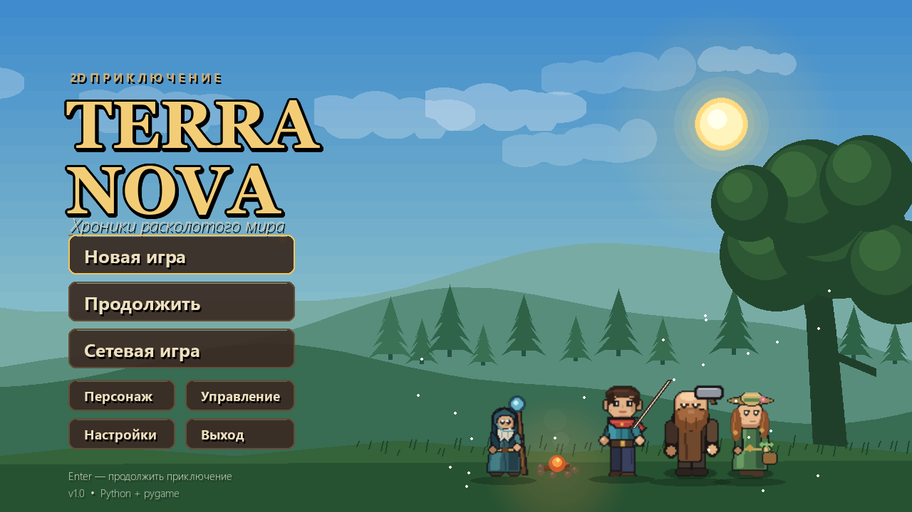
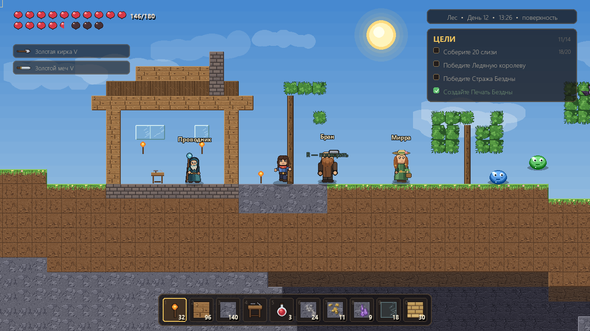
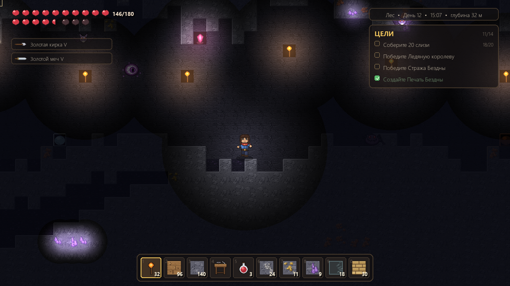
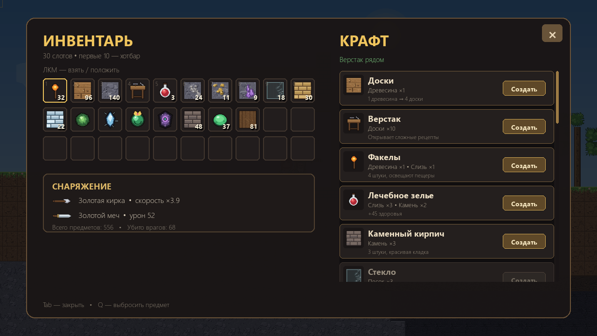
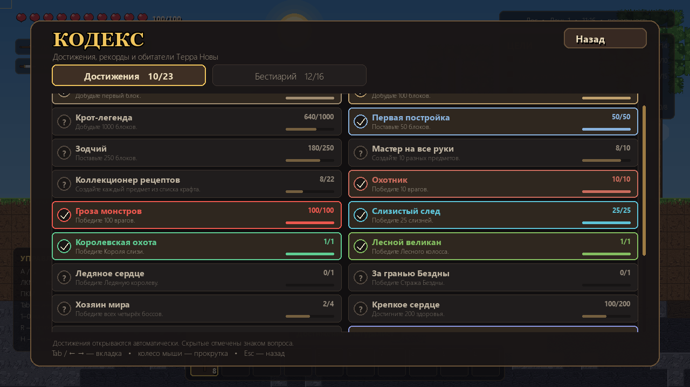

# TERRA NOVA — Хроники расколотого мира

Оригинальная 2D-песочница в духе Terraria, написанная на Python и pygame-ce.
Весь мир, графика, музыка и звуки создаются процедурно — внешние файлы ассетов
не нужны.





## Объединённая версия

Проект собран на базе рабочей **TerraNova**. Из незавершённой «ТЕРРАПИИ»
(папка `game/`) перенесены и адаптированы под здешний контент:

- система достижений (23 награды);
- бестиарий (16 записей: 12 обычных существ и 4 босса);
- экран «Кодекс» с двумя вкладками;
- сохранение с резервной копией `.bak` и загрузкой из неё при повреждении
  основного файла.

Остальная архитектура «ТЕРРАПИИ» не переносилась: в ней не было точки входа
и игровой сцены, поэтому она сохранена только как архив идей.

## Возможности

- Три размера процедурного мира: малый 1200 × 360, средний 2400 × 600 и
  большой 4200 × 1200 тайлов. Биомы: лес, пустыня, снежные пустоши, порча,
  пляж; пещеры, руды, деревья, кристаллы жизни и подземные пустоты.
- Полноценный персонаж: бег, прыжки, копание, строительство, ближний бой,
  факелы и освещение.
- Инвентарь на 30 слотов, хотбар на 10 слотов, крафт у верстака, 22 рецепта.
- Смена дня и ночи, пещерная темнота, погодные оттенки биомов.
- 12 видов обычных врагов: пять видов слизней, зомби, пещерные и морозные
  мыши, гнилые глаза, пещерные пауки, пустынные скорпионы и морозные волки.
- Четыре босса: **Король слизи**, **Лесной колосс**, **Ледяная королева** и
  финальный **Страж Бездны**. Каждый призывается своим предметом.
- 14 целей проводника: от первой древесины до финального босса и Лазурного
  берега.
- **Кодекс**: достижения и бестиарий с прогрессом, редкостью и описаниями.
- Двенадцать музыкальных тем (меню, биомы, день/ночь, пещера, боссы) и
  звуковые эффекты, синтезированные через numpy.
- Сохранение и загрузка с резервной копией, настройки громкости,
  полноэкранный режим, пауза, экраны смерти и победы.
- LAN-кооператив на двух игроков.
- Русский интерфейс и подсказки.

| Пещера | Инвентарь и крафт |
|---|---|
|  |  |

## Требования

- Windows, Linux или macOS;
- Python 3.11+ (проект проверен на Python 3.15.2);
- pygame-ce 2.5+;
- numpy 2.0+.

## Запуск в PyCharm

1. Распакуйте папку `TerraNova` (или откройте её как проект).
2. В PyCharm: **File → Open…** → выберите папку `TerraNova`.
3. Откройте **Settings → Project: TerraNova → Python Interpreter** и выберите
   интерпретатор Python 3.11+.
4. Установите зависимости. В терминале PyCharm (Alt+F12) выполните:

   ```bash
   python -m pip install -r requirements.txt
   ```

5. Откройте `main.py` и нажмите **Shift+F10** (Run 'main').

Рабочая директория проекта — корень `TerraNova`; запускать нужно именно
`main.py`, а не файлы из пакета `terranova`.

## Запуск из терминала

```bash
cd TerraNova
python -m pip install -r requirements.txt
python main.py
```

На Windows также можно дважды щёлкнуть `run.bat`.

## Управление

| Клавиша | Действие |
|---|---|
| `A` / `D` или `←` / `→` | движение |
| `Space` / `W` / `↑` | прыжок |
| ЛКМ | копать блок или атаковать врага |
| ПКМ | поставить блок / использовать предмет |
| `1` … `0` | выбор слота хотбара |
| Колесо мыши | переключение слотов |
| `Tab`, `C`, `I` или `E` | инвентарь и крафт |
| `K` | кодекс: достижения и бестиарий |
| `Q` | выбросить выбранный предмет |
| `H` | скрыть/показать подсказки |
| `Esc` | пауза / назад в меню |
| `F11` | полноэкранный режим |
| `Enter` | продолжить игру из главного меню |
| `R` | возродиться после смерти |

Копание и атака работают по удержанию ЛКМ. Прицел подсвечивает тайл:
зелёная рамка — блок можно поставить, красная — нельзя (нет опоры или
слишком далеко).

В кодексе: `Tab` или `←` / `→` переключают вкладки, колесо мыши и
`↑` / `↓` прокручивают список, `Esc` или `K` закрывают окно.

## Как играть

1. Срубите деревья: ЛКМ по стволу. Из древесины сделайте доски, затем верстак
   (Tab → «Крафт»).
2. Поставьте верстак (ПКМ) и стойте рядом с ним — откроются сложные рецепты.
3. Добудьте камень, железо и золото, улучшайте кирку и меч.
4. Собирайте слизь с врагов. Ночью будьте осторожнее: зомби сильнее слизней.
5. Найдите в пещерах кристаллы жизни — они навсегда добавляют +20 к максимуму
   здоровья (до 200). Ставьте факелы, чтобы видеть путь.
6. Создайте **Корону слизи** (20 слизи, 5 золота, 5 кристаллов), выберите её
   в хотбаре и используйте ПКМ на поверхности.
7. Победите Короля слизи. Дальше вас ждут Лесной колосс, Ледяная королева и
   Страж Бездны; их призыватели открываются по мере прогресса.
8. Соберите жителей у моря и завершите историю на Лазурном берегу.

## Кодекс

Кнопка **«Кодекс»** есть в главном меню, а в паузе — **«Кодекс и бестиарий»**.
Клавиша `K` открывает тот же экран из меню и во время игры.

- **Достижения** — 23 награды за добычу, строительство, крафт, убийства,
  боссов, исследование мира и финал. Прогресс сохраняется автоматически.
- **Бестиарий** — 16 записей. Обычные существа открываются после первого
  убийства, боссы отмечены золотой рамкой и отдельным счётчиком побед.
  Неизученные записи показываются как «Неизвестное существо».



## Сохранения и настройки

- `saves/world.json` — сохранение мира и персонажа (автосохранение каждые
  45 секунд, при выходе в меню и при закрытии игры).
- `saves/world.json.bak` — резервная копия предыдущего сохранения. Если
  основной файл повреждён, игра попробует загрузить `.bak`.
- `saves/settings.json` — громкость музыки/звуков, полноэкранный режим,
  тряска экрана.
- `saves/lan_world.json` — отдельное сохранение для LAN-игры.
- Чтобы начать заново, удалите `saves/world.json` и `saves/world.json.bak`.

## Структура проекта

```
TerraNova/
├─ main.py                 # точка входа
├─ requirements.txt
├─ run.bat
├─ assets/audio/           # сгенерированные музыка и звуки
├─ docs/screenshots/       # скриншоты для README
├─ saves/                  # сохранения (создаётся автоматически)
└─ terranova/
   ├─ config.py            # константы, тайлы, предметы
   ├─ world.py             # генерация мира, коллизии, RLE-сохранение
   ├─ entities.py          # игрок, враги, боссы, дроп, частицы
   ├─ crafting.py          # рецепты и цели
   ├─ progression.py       # достижения и бестиарий
   ├─ codex.py             # экран кодекса
   ├─ assets.py            # процедурная графика и шрифты
   ├─ audio.py             # синтез музыки и звуков
   ├─ network.py           # LAN-кооператив
   ├─ ui_widgets.py        # фон, кнопки, слайдеры
   ├─ ui.py                # меню, HUD, инвентарь, крафт
   ├─ utils.py             # JSON с резервной копией и мелкие функции
   └─ game.py              # игровой цикл и состояния
```

## Частые вопросы

**PyCharm пишет `ModuleNotFoundError: No module named 'pygame'`.**
Зависимости установлены не в тот интерпретатор. Проверьте
**Settings → Project → Python Interpreter** и выполните установку из его
терминала.

**Нет звука.**
Игра продолжит работать без аудио. Проверьте, что в системе выбрано
устройство вывода, и перезапустите игру. Громкость регулируется в настройках.

**Первый запуск долгий.**
Если папка `assets/audio` пуста, музыка синтезируется через numpy при первом
запуске (обычно меньше минуты). В этом проекте готовые WAV-файлы уже приложены.

**Как изменить разрешение?**
Базовое разрешение — 1280 × 720. Окно масштабируется средствами pygame;
`F11` включает полноэкранный режим.

**Куда пропало сохранение?**
Проверьте `saves/world.json.bak`: при повреждении основного файла игра
загружает резервную копию. Если не помогло, удалите оба файла, чтобы начать
новый мир.

## Примечание

TERRA NOVA — самостоятельная игра, вдохновлённая жанром песочниц. Она не
использует графику, музыку или другие ассеты Terraria. Спрайты, текстуры,
иконки, шрифтовая стилистика, музыка и звуки создаются кодом проекта.
